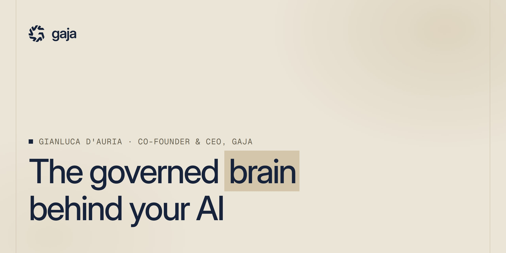

# Gianluca D'Auria

### AI knows everything except your company

At [gaja](https://trygaja.com) we build the governed brain behind your AI. A company's context sits across its tools and in people's heads: gaja turns calls, docs, messages and processes into persistent memory people and agents can securely rely on.

I run sales and partnerships. On GitHub I share what we learn building gaja: the same frameworks, plugins and skills we use on our own brain, free to copy.

**Co-founder & CEO** @ [gaja](https://trygaja.com) · previously co-founded ProspeIQ · ex Microsoft, Oracle and Salesforce

## Start here

- **[how-to-build-a-skill](https://github.com/unclegian/how-to-build-a-skill)**: from a process you run by hand to a Claude skill, in ten steps. The format, a template, a worked example with scripts and evals, and two skills that create and review skills.
- **[claude-personal-memory](https://github.com/unclegian/claude-personal-memory)**: a small personal brain in plain files you own. Point the Claude Desktop app at one file, and Claude builds your workspace with you, question by question.
- **[claude-code-daily](https://github.com/unclegian/claude-code-daily)**: the Claude Code tools I use every day, by category, with the install lines and what each costs on every message.
- **[claude-antislop](https://github.com/unclegian/claude-antislop)**: keeps the tells of AI writing out of what Claude writes. 61 patterns in English and Italian, hooks on every file and reply, and a skill that rewrites a draft until it is clean.

## Where I post

LinkedIn [in/gianlucadauria-gaja](https://www.linkedin.com/in/gianlucadauria-gaja/) · gaja on [LinkedIn](https://www.linkedin.com/company/gaja-brain/) · [trygaja.com](https://trygaja.com) · gianluca@trygaja.com

_currently: building gaja._
